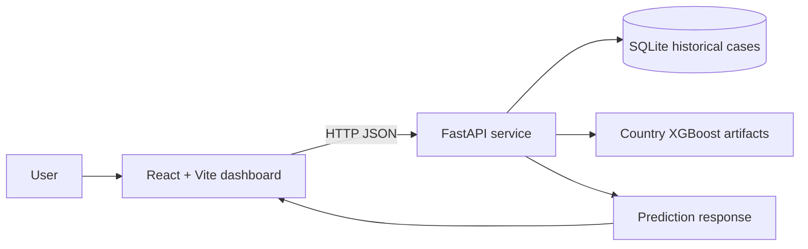

# Epidemic Predict Pro

A full-stack epidemic data exploration and prediction prototype built with React, FastAPI, XGBoost, and SQLite.

**Author:** Priyanshu Soni  
**Live demo:** https://epidemic-predict-ai-git-main-jais-projects-833fe4a0.vercel.app/

> **Research/prototype disclaimer:** This project is an educational and exploratory prototype. Its outputs are not medical advice, public-health guidance, or validated operational forecasts. Model performance has not yet been independently established in the repository.

## What it does

- Displays historical country-level case data on a map.
- Provides country selection and historical trend views.
- Exposes a prediction endpoint that loads country-specific XGBoost artifacts.
- Provides mobility-input scenario controls and feature-importance data where available.

## Architecture



See [architecture documentation](docs/architecture.md) for implementation details and current caveats.

## Technology

| Layer | Technologies |
|---|---|
| Frontend | React 19, Vite, Leaflet, Recharts, Axios |
| API | Python, FastAPI, Uvicorn, Pydantic |
| ML inference | XGBoost, joblib, pandas |
| Storage | SQLite |

## Repository layout

- `frontend/` — browser dashboard.
- `backend/main.py` — API endpoints and inference logic.
- `backend/seed_db.py` — database seeding script.
- `backend/epidemic_data.db` — SQLite database (if included in your checkout).
- `ai-pipeline/models/` — country model and feature-importance artifacts (if included).

**Training-code status:** The training script is present at `ai-pipeline/models/train_model.py` (not `backend/train_model.py`). It downloads Johns Hopkins global confirmed-case data, reads country-specific Google mobility CSV files from `ai-pipeline/data/`, builds lagged mobility features, and trains one XGBoost regressor per eligible country. The script must be run from `ai-pipeline/models/` for its relative input/output paths to resolve as written. Reproducibility still depends on obtaining the expected mobility files and compatible dependencies.

## Run locally

### 1. Clone

```bash
git clone https://github.com/priy0767/EpidemicPredictAI.git
cd EpidemicPredictAI
```

### 2. Backend

```bash
cd backend
python -m venv .venv
# Windows PowerShell:
.venv\Scripts\Activate.ps1
# macOS/Linux:
# source .venv/bin/activate
pip install -r requirements.txt
uvicorn main:app --reload
```

The API expects the SQLite database and model artifacts at the relative paths referenced in `backend/main.py`. Check that these files exist in your local checkout and that the model directory layout matches the API's expected paths before starting the service. The current requirements file may need additional packages depending on the exact frontend/backend environment; dependency pinning is a follow-up task.

API base URL: `http://localhost:8000`  
Interactive API docs: `http://localhost:8000/docs`

#### 3. Train country models (optional; requires the source mobility CSV files)

From the repository root, install the backend ML dependencies, then run the script from its own directory so its relative paths resolve:

```bash
cd backend
pip install -r requirements.txt
cd ../ai-pipeline/models
python train_model.py
```

The script expects mobility files such as `ai-pipeline/data/2020_IN_Region_Mobility_Report.csv` (and corresponding 2021/2022 files). It downloads the Johns Hopkins confirmed-case time series at runtime. It writes `model_XX.pkl` and `importance_XX.json` into the current `ai-pipeline/models/` directory. The script now uses a date-aware purge so training target windows end before the test period. It writes one `evaluation_XX.json` report per eligible country with test dates, sample counts, model MAE/RMSE/R², and a persistence-baseline comparison. These are run-specific measurements, not precomputed results committed to this repository. Run the split-helper tests from `ai-pipeline/models/` with `python -m unittest discover -s tests -v`. See [evaluation status](docs/evaluation-status.md) before interpreting the metrics.

### 4. Frontend

In a second terminal:

```bash
cd frontend
npm install
npm run dev
```

Vite normally serves the dashboard at `http://localhost:5173`.

## API overview

| Method | Endpoint | Purpose |
|---|---|---|
| GET | `/api/countries` | Returns supported country names |
| GET | `/api/map_snapshot` | Returns historical cumulative-case snapshot |
| GET | `/api/global_predictions` | Returns country-level estimates using available models or fallback values |
| POST | `/api/predict` | Runs the country model and scenario calculation |

For request fields and implementation details, inspect [backend/main.py](backend/main.py).

## Prediction behavior and evaluation status

The `/api/predict` endpoint currently computes an XGBoost prediction and a separate hand-written mobility scenario estimate, then averages the two. This is a hybrid application rule, not a separately trained ensemble. The global endpoint also uses zero-valued mobility inputs and fallback estimates when model/data conditions are not met.

No verified held-out chronological MAE, RMSE, or R² results are published in this repository yet. See:
- [Evaluation status](docs/evaluation-status.md)
- [Known limitations](docs/limitations.md)

Metrics should only be added after the training pipeline, target definition, time-based split, feature construction, and baseline comparison have been reproduced and checked. Do not interpret training scores as future forecasting performance.

## Security and deployment notes

The current API source contains permissive CORS settings and SQL statements assembled with string interpolation. These should be reviewed before production use. Keep credentials and private configuration out of source control, restrict CORS to trusted frontend origins, and use parameterized SQL queries.

## Contributing

Issues and pull requests are welcome. When changing the modeling pipeline, include:
1. Reproducible data and preprocessing steps.
2. A chronological train/validation/test strategy.
3. Metrics against a simple baseline.
4. Tests for feature construction and prediction behavior.
5. Clear notes on data limitations and intended use.

## License

No license file was identified during this documentation pass. Until a license is added, the repository should not be assumed to grant general reuse or redistribution rights.
