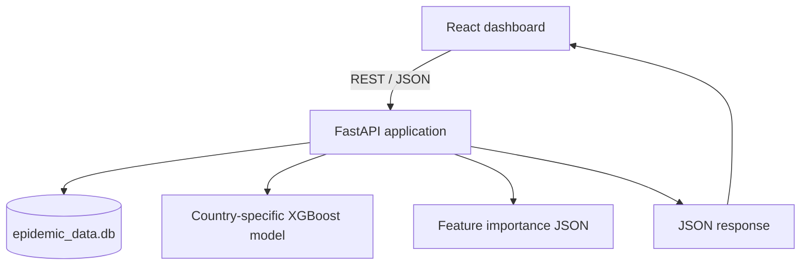

# System Architecture

## Runtime flow

## Components

### Frontend
The React/Vite application presents country selection, maps, historical trends, and scenario controls. It communicates with the backend over HTTP.

### Backend
`backend/main.py` defines four routes:

- `GET /api/countries`: returns the configured country list.
- `GET /api/map_snapshot`: queries historical cumulative cases from SQLite.
- `GET /api/global_predictions`: calculates each country's latest seven-day average daily cases, predicts the next-week average daily case count with the country model, and identifies countries using a persistence fallback.
- `POST /api/predict`: derives the latest seven-day average daily cases from SQLite, applies the submitted mobility features to the country model, and returns the predicted next-week average daily cases.

### Data and model artifacts
The API resolves the SQLite database and model directory from the repository structure, with `EPIDEMIC_DATABASE_PATH` and `EPIDEMIC_MODEL_DIR` overrides. The prediction route expects files named `model_<COUNTRY_CODE>.pkl` and optionally `importance_<COUNTRY_CODE>.json`.

## Important implementation details

1. The trained target is the average daily case count over the next seven days. It is not a seven-day cumulative total or a fourteen-day total.
2. The single-country route derives the current seven-day average from the latest seven historical database rows. Mobility values supplied by the UI are used as model features; the previous hand-written scenario blend has been removed.
3. The global route currently supplies zero mobility values because it has no country-specific mobility input endpoint. It uses the current seven-day average as a persistence fallback and lists fallback countries in its response.
4. The map color bands are visual magnitude bands only; they are not clinical or public-health risk classifications.
5. CORS is configurable through `CORS_ORIGINS`, SQL values are parameterized, and API paths are configurable. Production deployments must set the exact frontend origins.

## Unverified areas

The training script referenced by the old README was not found at `backend/train_model.py` or at the repository root during this pass. The full training pipeline, feature-generation process, model serialization provenance, and evaluation procedure still need to be audited from the original local project files.
