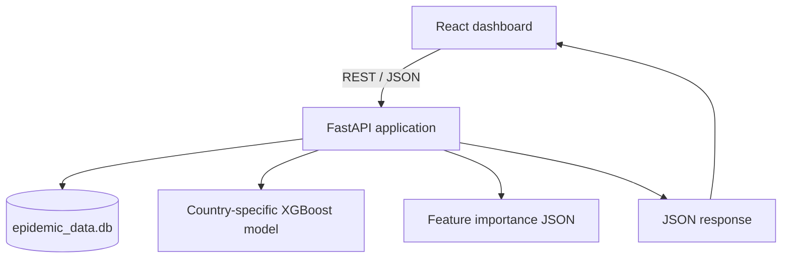

# System Architecture

## Runtime flow

## Components

### Frontend
The React/Vite application presents country selection, maps, historical trends, and scenario controls. It communicates with the backend over HTTP.

### Backend
`backend/main.py` defines four routes:

- `GET /api/countries`: returns the configured country list.
- `GET /api/map_snapshot`: queries historical cumulative cases from SQLite.
- `GET /api/global_predictions`: loads country models where available; otherwise it falls back to a baseline estimate.
- `POST /api/predict`: loads one country's model, retrieves recent history, calculates a model output and a scenario estimate, and returns a combined value.

### Data and model artifacts
The API expects `epidemic_data.db` in its working directory and model files under `../ai-pipeline/models/`. The prediction route expects files named `model_<COUNTRY_CODE>.pkl` and optionally `importance_<COUNTRY_CODE>.json`.

## Important implementation details

1. `/api/predict` averages the XGBoost output with a manually calculated mobility scenario value. This should be described as a hybrid application calculation, not a trained ensemble.
2. `/api/global_predictions` supplies zero for all mobility inputs and multiplies a daily estimate by 14. This is not equivalent to a fully featured 14-day time-series rollout.
3. The global route uses fallback estimates when a model is absent or inference fails.
4. The API currently allows all CORS origins and uses interpolated SQL strings in several queries. These are security and robustness issues to address before production use.

## Unverified areas

The training script referenced by the old README was not found at `backend/train_model.py` or at the repository root during this pass. The full training pipeline, feature-generation process, model serialization provenance, and evaluation procedure still need to be audited from the original local project files.
